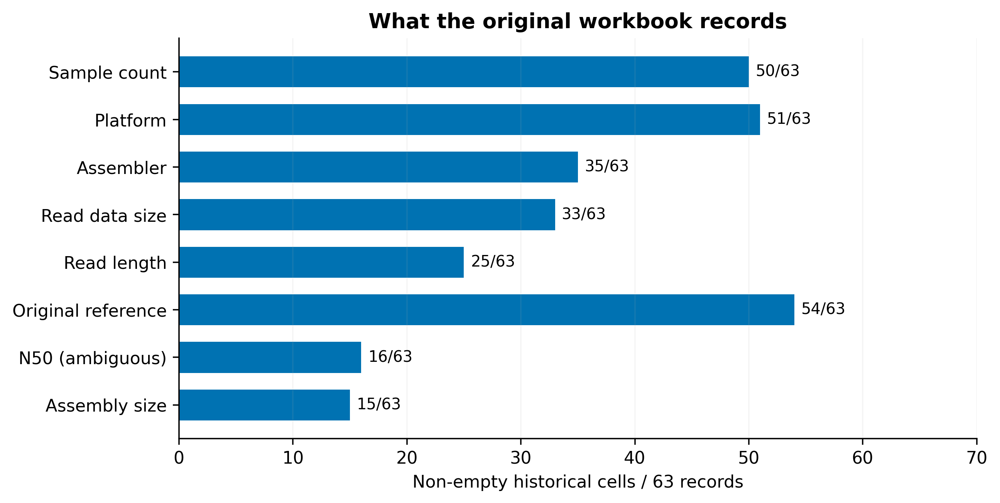

# Metagenomic Binning Benchmark Atlas

**Which metagenomic binning benchmarks can we fairly compare?** A provenance-aware catalog, bounded scoping review and executable common-protocol evaluation.



## What is here

- **63 historical subset records**, 33 provisional families and 1008 cell-traceable fields, imported from the most complete workbook revision.
- **82 audit flags** for ambiguous quantities, tool roles, identifiers and related inconsistencies; these are observations, not confirmed-error counts.
- **13 article citations** checked against 11 primary repositories, with an explicit extraction boundary and a 2026 resource discovery.
- **Two official public outputs re-evaluated** with AMBER 2.0.8 on the same CAMI_low sample/truth: CONCOCT mean purity 0.837, mapped-genome completeness 0.933; MaxBin 0.948 and 0.826.

[Explore the static site](https://martaforjaz.github.io/metagenomic-binning-benchmark-atlas/) · [Technical report (PDF)](docs/technical_report.pdf) · [Report (Markdown)](docs/technical_report.md) · [Catalog CSV](data/curated/datasets.csv) · [Scoping review](docs/review.md) · [Publication status](docs/publication.md)

## Read the evidence correctly

Metadata plots measure presence in the historical workbook, **not missing reporting in papers**. Catalog claims remain historically unverified with field-level provenance. All historical ground-truth statuses are not extracted; they do not mean truth is absent. Reported reuse edges are not newly verified study relationships. The literature review is bounded and repository-assisted: full-text/supplement review and external archive access are incomplete. No global ranking is produced.

The experiment recalculates archived official examples on simulated CAMI data; it does **not** execute binners or assess current method performance. AMBER 2 mapped-genome completeness differs from CAMI 1 completeness. See the [fixed protocol](experiments/protocol.json), [metrics](results/metrics.csv) and [execution record](results/run.json).

## Reproduce

Linux, Python 3.12, Git, uv and make. No GPU or large sequencing downloads.

```sh
make setup
make reproduce
make test
make experiment
make reproduce
```

[Complete instructions](docs/reproduce.md) · [Data dictionary](docs/data_dictionary.md) · [Audit](docs/audit.md) · [Provenance and access](docs/provenance.md) · [References](bibliography.bib)

## Research context

The 2024 NOVA undergraduate project, supervised by Andre Lamurias, involved literature research and dataset tables. This **2026 independent extension** adds the software, provenance model, audit, current scoped review and re-evaluation. It does not imply the former supervisor's participation or approval. Original administrative documents, video and third-party illustrations are not redistributed. All displayed figures are newly generated.

Metagenomic binning groups assembled DNA fragments into candidate genomes. Composition, abundance and assembly graphs provide complementary evidence, but a bin is not automatically a complete or uncontaminated genome. Fair evaluation requires a matching sequence universe, ground truth, task, filters and metrics.

Code: MIT. Original curation/text/figures: CC BY 4.0. External articles, metadata, tools and example data retain their own terms; [licenses and attribution](LICENSES.md). Maintained by Marta Forjaz. Review date: 5 November 2026.
