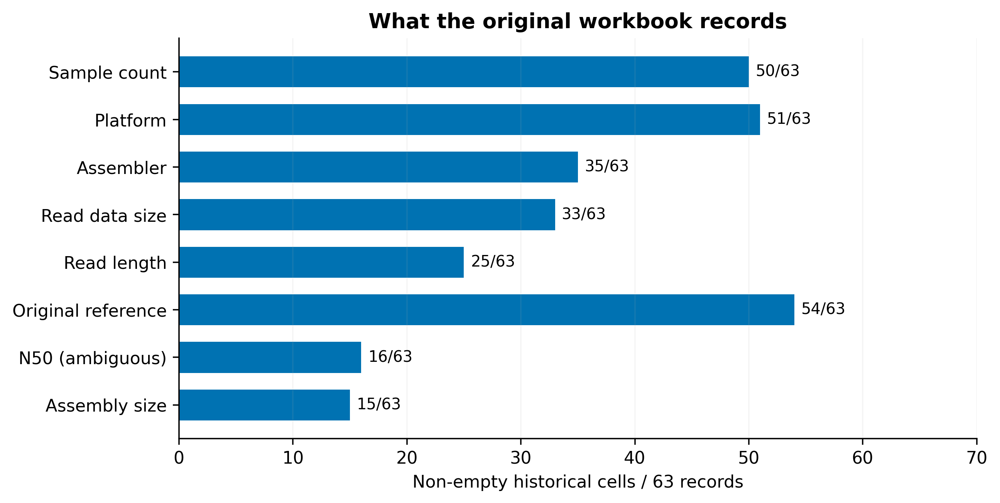
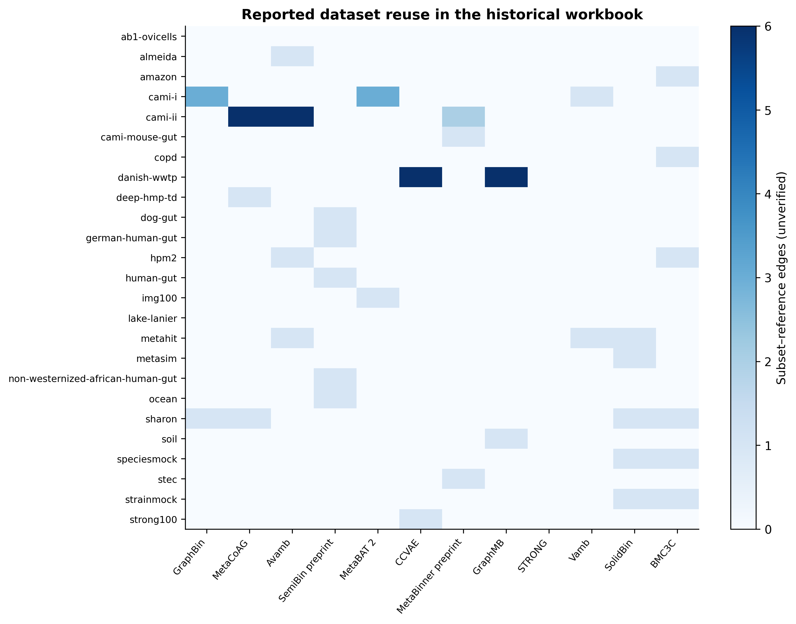
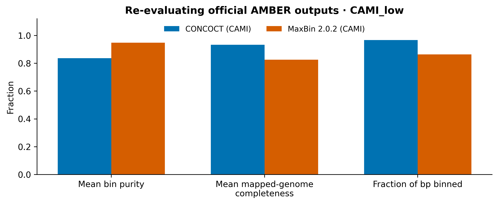

# Metagenomic Binning Benchmark Atlas

Technical report · 5 November 2026 · Independent extension by Marta Forjaz

## Abstract

This resource converts a historical undergraduate dataset workbook into a reproducible, provenance-aware research artifact. It contains 63 historical subset records in 33 provisional families, 1008 cell-traceable field assertions, 81 workbook-reported reuse relationships and 82 audit flags. A bounded repository-assisted scoping review verifies 13 article citations against 11 primary repositories. A common AMBER 2.0.8 protocol successfully re-evaluates two public official example outputs for CAMI_low. No binners were run. The contribution is integration, validation and reproducible evaluation, not a claim of new binning methodology or exhaustive literature coverage.

## 1. Background and research questions

Metagenomic sequencing mixes DNA from multiple organisms. Assembly reconstructs longer fragments (contigs); binning groups fragments into candidate genomes, often using composition, abundance and assembly connectivity. A bin is a hypothesis about genome membership, not automatically a complete, uncontaminated genome. Known simulated/mock truth supports direct assignment evaluation; marker-based estimates on real communities answer a related but different question.

RQ1: Which datasets and protocols are used? RQ2: What documentation supports reproduction? RQ3: Which conditions support fair cross-study comparison? RQ4: Can a small common-protocol evaluation be reproduced?

## 2. Historical work versus the independent extension

The original January-February 2024 NOVA undergraduate placement, supervised by Andre Lamurias, documented literature reading, weekly meetings and successive dataset tables. Its report describes an intended baseline evaluation but supplies no executed baseline artifacts. This extension does not attribute new work or endorsement to the former supervisor. The original PDF/activity sheet remain private because they contain administrative personal information; the video and third-party illustration are not redistributed.

The extension performs scientific-cell extraction, conservative normalization, explicit provenance and uncertainty modelling, a scoped current repository review, executable validation, descriptive analysis and public-output re-evaluation. Derived literature observations, historical claims and newly calculated experimental results remain separate.

## 3. Data and provenance methods

Table4 is the most complete workbook revision. Rows 6-68 define the canonical record population. Earlier tables are recovery candidates, not independent datasets. The private original's SHA-256 is recorded in workbook_manifest.json. Public scientific extracts support reproduction without requiring the private attachments. No original administrative document is included.

The unit of catalog analysis is a historical dataset subset row, not an individual sequence, sample, family or paper. The 33 families are provisional label/context groups; shared accession does not establish identical sequence contents. Separate CSVs model assemblies, field claims, reported reuse, reviewed studies and source verification. Numeric conversions use explicit units or the column heading, never infer ambiguous products. All converted historical values remain historically unverified.

Each of 16 fields per subset has a raw value, source cell and status. Missing or slash cells mean not extracted; they do not prove absence from a publication. Not-found-after-check requires a specific source inspection. Not-applicable and access-unconfirmed are separate states. See data_dictionary.md and audit.md for schema and exact examples.

The audit found ambiguous Gbp products, suspect N50 units, missing assembly-size units, mock/simulation conflicts, possible species-versus-sample counts and shared accessions. 82 flags include shared-accession pairs and multiple observations on the same record; they are not a count of confirmed independent errors. Earlier revisions are preserved as candidates; complete manual reconciliation remains unfinished.

## 4. Bounded current review

A new primary-source search was attempted on 5 November 2026. Europe PMC and publisher access were denied by the outbound proxy. No search-result counts are claimed. A documented repository-assisted thematic selection then inspected CAMI/AMBER, Vamb, SemiBin and linked graph, strain, simulation and contrastive-learning resources. Exact immutable source URLs, checksums and evidence excerpts are public. Thirteen article citations were checked against author/community documentation, not all full texts. Search strategy, inclusion criteria, thematic stop rule, synthesis and limits are in review.md.

CAMI I/II and CAMISIM establish why release, sample and simulation configuration matter [cami1; cami2; camisim]. GraphBin refines prior labels; MetaCoAG and GraphMB require graph-related inputs with different assumptions [graphbin; metacoag; graphmb]. Vamb/Avamb, SemiBin/SemiBin2 and COMEBin use different learned representations and training information [vamb; avamb; semibin; semibin2; comebin]. MetaBinner adds ensemble construction [metabinner]. The Vamb README also links a 2026 TaxVamb DOI, retained as an incompletely extracted current resource rather than a fully reviewed article. A complete publication-level reporting assessment is outside this release's verified evidence.

## 5. Computed catalog results

All metadata-presence percentages use the same denominator: 63 canonical subset rows. They measure whether the historical workbook contains a nonempty assertion, never whether authors documented the field. No reporting-quality percentage or weighted reproducibility score is inferred.

| Field | Nonempty historical cells | Denominator | Percentage |
|---|---:|---:|---:|
| samples | 50 | 63 | 79.37% |
| platform | 51 | 63 | 80.95% |
| simulator | 14 | 63 | 22.22% |
| assembler | 35 | 63 | 55.56% |
| origin | 63 | 63 | 100.0% |
| size | 33 | 63 | 52.38% |
| read_length | 25 | 63 | 39.68% |
| environment | 61 | 63 | 96.83% |
| ncbi | 39 | 63 | 61.9% |
| ena | 3 | 63 | 4.76% |
| link_ref | 30 | 63 | 47.62% |
| original_ref | 54 | 63 | 85.71% |
| year | 54 | 63 | 85.71% |
| reuse_refs | 43 | 63 | 68.25% |
| n50 | 16 | 63 | 25.4% |
| assembly_size | 15 | 63 | 23.81% |

Figure 1. Historical metadata presence, denominator 63 subset records. Nonempty cells can still be wrong or ambiguous; missing cells are not paper omissions. Data: field_presence.csv.

The reuse analysis counts workbook-reported subset-reference relationships. It is not a newly confirmed study-dataset bipartite graph. Family aggregation sums relationships and can count several subsets from one family/study; no independent-study rate is calculated. The selected matrix columns are disclosed in the analysis script. Origin and technology plots describe the historical selection; contradictory origin labels remain a visible category. All 63 historical ground-truth statuses are not extracted, not “no truth available”. The official AMBER truth artifact is verified separately.

Figure 2. Workbook-reported reuse, aggregated by provisional family for selected references. Cells count subset-reference edges, not independent experiments. Unverified and incomplete.

## 6. Predeclared small evaluation

The protocol was saved before successful execution in experiments/protocol.json. Dataset: official CAMI I low-complexity gold-standard assembly example, SampleID CAMI_low; exact input identity comes from checksums, not label alone. Upstream AMBER commit f8b3a601043d13fc4227d5691c13561eb4490e50, evaluator version 2.0.8. Two prediction files are labelled CONCOCT (exact binary version not established) and MaxBin 2.0.2 (upstream label).

Three assignments and the genome-removal table total less than 3 MB. No raw reads or assemblies were reconstructed. Inputs remain upstream and are fetched with an immutable commit and validated hashes. The AMBER repository is GPL-3.0; upstream fixtures are not redistributed. The task verifies equal SampleID, unique sequence IDs and that prediction IDs belong to the gold standard.

Settings follow the official tested example: remove genomes marked “circular element”, discard 1% smallest predicted bins, minimum sequence length 0, completeness thresholds 50/70/90% and contamination thresholds 10/5%. Compute limits: 2 numeric-library threads, 180-second subprocess timeout, 3 MB input cap. Wall time is measured for the AMBER subprocess including its report generation, not binner training or a performance benchmark. Peak memory was not measured. Definitions follow AMBER's source/documentation [amber].

Mean purity (precision_avg_bp) is the unweighted mean of within-bin dominant-genome bp fractions. Mean completeness (recall_avg_bp) is AMBER 2 mapped-genome completeness; genomes without a mapped prediction are treated differently by the CAMI 1 metric. Binned bp fraction uses the evaluator's sample universe. Accuracy counts correctly assigned dominant-genome bp over the complete sample. The adjusted Rand index uses the evaluator's bp partition definition. Raw evaluator output preserves all metrics, including alternative CAMI 1 averages. Do not mix these definitions.

| Official output | Mean purity | Mean mapped-genome completeness | Binned bp fraction | Accuracy | Adjusted Rand index |
|---|---:|---:|---:|---:|---:|
| CONCOCT (CAMI) | 0.837135 | 0.933410 | 0.966790 | 0.663234 | 0.643557 |
| MaxBin 2.0.2 (CAMI) | 0.947763 | 0.825796 | 0.863569 | 0.809257 | 0.917149 |

Measured AMBER subprocess wall time for the recorded run: 7.74 seconds; Python 3.12.14; exit code 0. Gold-standard input: 19499 sequence identifiers and 60 genome identifiers before requested removals. Full command and timestamp are in results/run.json. The upstream expected-output fixture independently agrees with the selected numeric results within 1e-6.

Figure 3. Recomputed official example metrics. Same sample/truth and evaluator settings, archived predicted outputs. CONCOCT shows higher mapped-genome completeness and MaxBin higher purity in this specific example. No binners were run. These results are not a benchmark of current tools or evidence of biological novelty.

## 7. Answers, limitations and next work

RQ1: The historical collection covers CAMI releases, environmental/human communities, simulations, mixtures and long-read examples, but many variant identities and quantities require primary confirmation. RQ2: The workbook's field presence can be measured reproducibly; publication-level data/code/instruction availability cannot be inferred from it and has not been exhaustively assessed. RQ3: Fair comparison needs matching sample/assembly, truth universe, original training/features, filters, binning task and metric semantics. RQ4: Yes: two official archived outputs were successfully re-evaluated with one common AMBER protocol, bounded to an illustrative public example.

Coverage is selective, inherited labels may be wrong, and families are provisional. The current source review is repository-documentation based with incomplete full texts, supplements and external archive checks. The 2026 resource discovery is not evidence of exhaustive 2026 literature coverage. No dataset archive is declared complete or usable from a URL or HTTP response alone. No global method ranking is supported. Provenance of some historical citations remains contradictory.

Next priorities: full-text/supplement extraction; resolve flagged quantity, accession and sample-count claims; verify exact biological archive manifests and redistribution terms; expand beyond the official example using matched archived outputs; add strain-aware evaluation only with appropriate truth and denominators. These would strengthen scientific scope without treating interface work as research evidence.

## 8. Reproduction and publication

Run make setup, make reproduce, make test, make experiment, then make reproduce. The lockfile includes package hashes; the original administrative attachments are unnecessary. Scientific figures are exported as PDF, SVG and 320-dpi PNG. The static site uses no external assets or backend. See docs/reproduce.md for full instructions. GitHub publication state and any remaining Pages activation are reported separately in docs/publication.md; local generation does not establish public deployment.

## References

[cami1] Critical Assessment of Metagenome Interpretation—a benchmark of metagenomics software (2017). https://doi.org/10.1038/nmeth.4458 . Citation checked against src-amber; article full text not independently retrieved.

[cami2] Critical Assessment of Metagenome Interpretation: the second round of challenges (2022). https://doi.org/10.1038/s41592-022-01431-4 . Citation checked against src-amber; article full text not independently retrieved.

[amber] AMBER: Assessment of Metagenome BinnERs (2018). https://doi.org/10.1093/gigascience/giy069 . Citation checked against src-amber; article full text not independently retrieved.

[camisim] CAMISIM: Simulating metagenomes and microbial communities (2019). https://doi.org/10.1186/s40168-019-0633-6 . Citation checked against src-camisim; article full text not independently retrieved.

[vamb] Improved metagenome binning and assembly using deep variational autoencoders (2021). https://doi.org/10.1038/s41587-020-00777-4 . Citation checked against src-vamb; article full text not independently retrieved.

[avamb] Adversarial and variational autoencoders improve metagenomic binning (2023). https://doi.org/10.1038/s42003-023-05452-3 . Citation checked against src-vamb; article full text not independently retrieved.

[semibin] A deep siamese neural network improves metagenome-assembled genomes in microbiome datasets across different environments (2022). https://doi.org/10.1038/s41467-022-29843-y . Citation checked against src-semibin; article full text not independently retrieved.

[semibin2] SemiBin2: self-supervised contrastive learning leads to better MAGs for short- and long-read sequencing (2023). https://doi.org/10.1093/bioinformatics/btad209 . Citation checked against src-semibin; article full text not independently retrieved.

[graphbin] GraphBin: refined binning of metagenomic contigs using assembly graphs (2020). https://doi.org/10.1093/bioinformatics/btaa180 . Citation checked against src-graphbin; article full text not independently retrieved.

[graphmb] Metagenomic binning with assembly graph embeddings (2022). https://doi.org/10.1093/bioinformatics/btac557 . Citation checked against src-graphmb; article full text not independently retrieved.

[metacoag] Accurate Binning of Metagenomic Contigs Using Composition, Coverage, and Assembly Graphs (2022). https://doi.org/10.1089/cmb.2022.0262 . Citation checked against src-metacoag; article full text not independently retrieved.

[comebin] Effective binning of metagenomic contigs using contrastive multi-view representation learning (2024). https://doi.org/10.1038/s41467-023-44290-z . Citation checked against src-comebin; article full text not independently retrieved.

[metabinner] MetaBinner: a high-performance and stand-alone ensemble binning method to recover individual genomes from complex microbial communities (2023). https://doi.org/10.1186/s13059-022-02832-6 . Citation checked against src-metabinner; article full text not independently retrieved.

